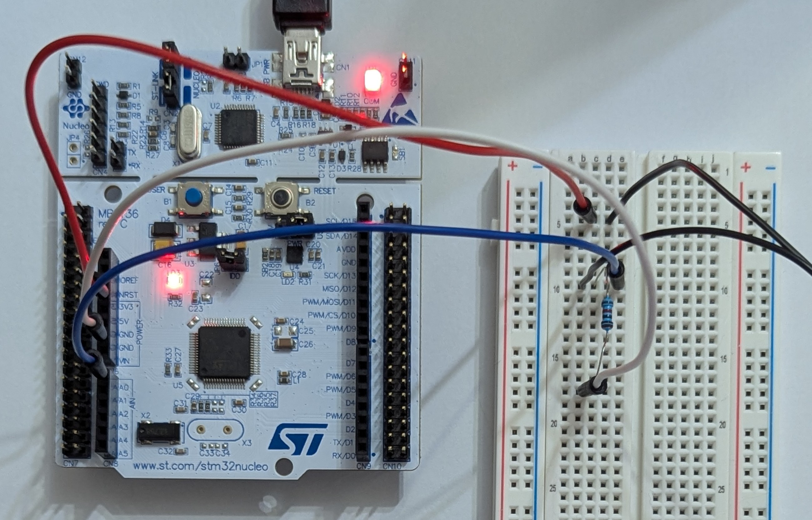
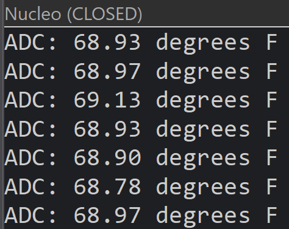

# STM32 Weather Station

A hobby weather station built in phases on an STM32 Nucleo-F446RE, written in C with STM32CubeIDE and the ST HAL. The goal is to learn embedded firmware from the ground up: GPIO, UART, ADC, I2C, and timers first, then register-level drivers, wireless, low power, and a custom PCB.

## Hardware

- NUCLEO-F446RE (STM32F446RET6, Cortex-M4F, 180 MHz)

- Adafruit BME280 temperature, humidity, and pressure sensor (I2C)

- Adafruit 1.3" 128x64 SSD1306 OLED (I2C)

- 10k NTC thermistor (3950 beta) in a voltage divider

- STEMMA QT cables and a breadboard

## Toolchain

- STM32CubeMX 6.18.1 for peripheral configuration and code generation

- STM32CubeIDE 2.2.0 for building, flashing, and debugging

- STM32Cube FW_F4 V1.28.3

## Projects

| Project | What it does | Concepts |
|---|---|---|
| blinky | Toggles the onboard LED (PA5) | GPIO output, HAL_Delay |
| uart_hello | Prints messages and a counter to a PC over the ST-LINK virtual COM port | USART2, snprintf, HAL_UART_Transmit |
| oled_hello | Displays centered text on the SSD1306 OLED | I2C1, pin remapping, third-party driver integration, framebuffers |
| thermistor_adc | Reads a thermistor on the ADC and prints temperature in °F once a second | 12-bit ADC polling, beta equation, float math on the M4F FPU, HAL status checking |

## Roadmap

1. **Board basics** (in progress): GPIO, UART, ADC, timer interrupts, button input, register-level blink

2. **Indoor station:** BME280 and OLED on I2C, button-cycled screens, dew point

3. **Data:** stream readings to a Python script, microSD logging over SPI

4. **Wireless:** ESP32-S3 bridge over UART to a web dashboard

5. **Outdoors:** wind and rain sensors, radiation shield enclosure, solar and LiFePO4 power, sleep modes

6. **Custom PCB:** KiCad sensor carrier board, then a full STM32L board

## Building

Each folder is a standalone STM32CubeIDE project. Import it with File > Import > STM32 > STM32CubeMX/STM32CubeIDE Project, or open the .ioc in STM32CubeMX to view or regenerate the configuration. Build output (Debug/) is not committed.

## Credits

oled_hello uses the [afiskon/stm32-ssd1306](https://github.com/afiskon/stm32-ssd1306) driver library.

